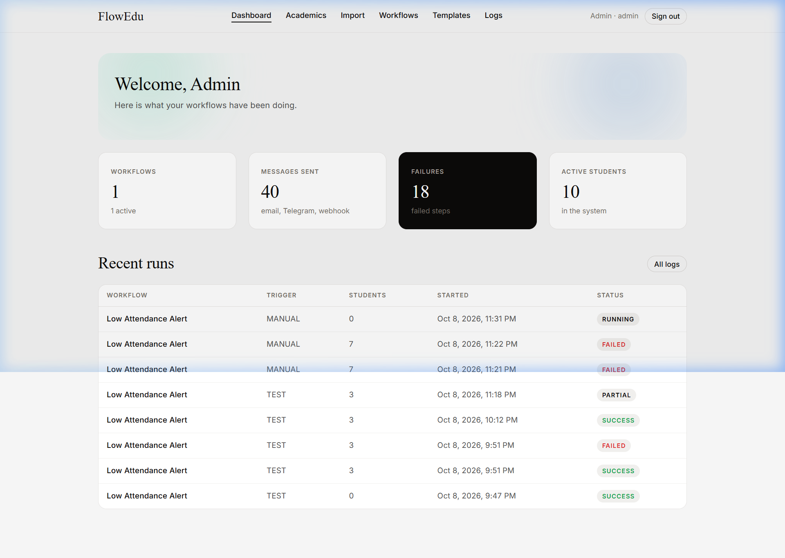

<div align="center">

# FlowEdu

### Intelligent Academic Workflow Automation Platform

**Automate student engagement. Detect at-risk learners. Deliver AI-powered interventions — across email, Telegram, and in-app notifications.**

[](https://openjdk.org/)
[](https://spring.io/projects/spring-boot)
[](https://react.dev/)
[](https://vitejs.dev/)
[](LICENSE)

[Features](#-features) · [Quick Start](#-quick-start) · [Architecture](#-architecture) · [API Reference](#-api-reference) · [Configuration](#%EF%B8%8F-configuration) · [Contributing](#-contributing)

---



*Admin dashboard showing workflow metrics, execution history, and real-time status monitoring.*

</div>

---

## The Problem

Universities lose **15-20% of students** to academic disengagement every year. By the time a faculty member notices a struggling student, it's often too late. Manual tracking across spreadsheets, emails, and disparate systems means early warning signs are missed.

## The Solution

**FlowEdu** is an end-to-end platform that connects academic data (attendance, marks, assignments) to automated intervention workflows. When a student's attendance drops below 75%, FlowEdu can automatically generate a personalized AI message and deliver it via email, Telegram, or in-app notification — all without manual intervention.

---

## Key Features

<table>
<tr>
<td width="50%">

### Workflow Automation Engine
Build powerful automation rules with a visual drag-and-drop interface. Set triggers (event, cron, or date-based), define audience filters, add conditions, and chain multi-step actions.

- Event triggers: `MARKS_UPLOADED`, `ASSIGNMENT_SUBMITTED`
- Cron scheduling for recurring reports
- Date triggers: "3 days before deadline"
- Multi-step pipelines with retry and fallback

</td>
<td width="50%">

### AI-Powered Messaging
Generate personalized student communications using multi-provider AI with automatic failover.

- **Gemini** (primary) → **Groq** (fallback) → **OpenRouter** (fallback)
- Context-aware prompts with student data variables
- Falls back to plain templates if all AI providers fail
- All providers have free tiers — zero cost to get started

</td>
</tr>
<tr>
<td width="50%">

### At-Risk Student Detection
Algorithmic risk scoring identifies struggling students before they fall behind.

- **Weighted scoring**: Attendance (40%) + Marks (35%) + Submissions (25%)
- Configurable thresholds per institution
- Risk factor breakdown per student
- Sorted by severity for quick action

</td>
<td width="50%">

### Multi-Channel Delivery
Reach students where they are — not just where you are.

- **Email** via SMTP (Gmail, Outlook, institutional)
- **Telegram** via Bot API (instant mobile reach)
- **In-app notifications** with read/unread tracking
- **Webhooks** for custom integrations

</td>
</tr>
<tr>
<td width="50%">

### Bulk Data Operations
Import and export academic data at scale.

- CSV import for students, attendance, marks
- Auto-creates departments and courses on import
- Authenticated CSV export with JWT tokens
- Sample data files included for testing

</td>
<td width="50%">

### Role-Based Access Control
Three distinct roles with granular permissions.

- **Admin**: Full platform control, user management, audit logs
- **Teacher**: Academic management, workflows, announcements
- **Student**: Personal dashboard, notifications, profile

</td>
</tr>
</table>

---

## Quick Start

### Prerequisites

| Tool | Version | Purpose |
|------|---------|---------|
| **Java** | 21+ | Backend runtime |
| **Maven** | 3.9+ | Backend build |
| **Node.js** | 18+ | Frontend runtime |

### 1. Clone & Launch

```bash
# Clone the repository
git clone https://github.com/shubhydv334-alt/Flowedu.git
cd Flowedu
```

```bash
# Start the backend (port 8080)
cd backend
mvn spring-boot:run
```

```bash
# In a new terminal — start the frontend (port 5173)
cd frontend
npm install
npm run dev
```

### 2. Open & Login

Navigate to **http://localhost:5173** and sign in with any demo account:

<div align="center">

| Role | Email | Password |
|:----:|:-----:|:--------:|
| **Admin** | `admin@flowedu.local` | `admin123` |
| **Teacher** | `teacher@flowedu.local` | `teacher123` |
| **Student** | `student@flowedu.local` | `student123` |

</div>

> Demo data (10 students, departments, courses, attendance records) is auto-seeded on first launch.

### 3. Try a Workflow

1. Login as **Admin** → go to **Templates**
2. Click **"Low Attendance Alert"** → it pre-fills a complete workflow
3. Hit **Test Run** to see it execute against sample data
4. Check **Logs** to inspect every step's input, output, and status

---

## Architecture

```
┌─────────────────────────────────────────────────────────┐
│                      FRONTEND                           │
│                                                         │
│   React 18  ·  Vite 5  ·  React Router v7              │
│                                                         │
│   ┌──────────┐ ┌──────────┐ ┌──────────┐ ┌──────────┐  │
│   │  Login   │ │Academics │ │Workflows │ │Dashboard │  │
│   └──────────┘ └──────────┘ └──────────┘ └──────────┘  │
│   ┌──────────┐ ┌──────────┐ ┌──────────┐ ┌──────────┐  │
│   │  Import  │ │ At-Risk  │ │  Logs    │ │ Profile  │  │
│   └──────────┘ └──────────┘ └──────────┘ └──────────┘  │
└───────────────────────┬─────────────────────────────────┘
                        │ REST API (JWT Auth)
┌───────────────────────┴─────────────────────────────────┐
│                      BACKEND                            │
│                                                         │
│   Spring Boot 3.3  ·  Spring Security  ·  JPA           │
│                                                         │
│   ┌──────────────────────────────────────────────────┐  │
│   │              Workflow Engine                      │  │
│   │  ┌─────────┐ ┌──────────┐ ┌───────────────────┐ │  │
│   │  │Triggers │→│Conditions│→│    Actions         │ │  │
│   │  │event    │ │attendance│ │ Email · Telegram   │ │  │
│   │  │cron     │ │marks     │ │ AI · Webhook       │ │  │
│   │  │date     │ │custom    │ │ (retry + fallback) │ │  │
│   │  └─────────┘ └──────────┘ └───────────────────┘ │  │
│   └──────────────────────────────────────────────────┘  │
│                                                         │
│   ┌──────────┐ ┌──────────┐ ┌──────────┐ ┌──────────┐  │
│   │   Auth   │ │ Academic │ │   Risk   │ │  Audit   │  │
│   │  (JWT)   │ │   CRUD   │ │ Scoring  │ │ Logging  │  │
│   └──────────┘ └──────────┘ └──────────┘ └──────────┘  │
└───────────────────────┬─────────────────────────────────┘
                        │
              ┌─────────┴─────────┐
              │   H2 Database     │
              │  (file-based)     │
              │  Zero config      │
              │  Swap to PG/MySQL │
              └───────────────────┘
```

### Tech Stack

| Layer | Technology | Why |
|-------|-----------|-----|
| **Runtime** | Java 21 | Modern LTS with virtual threads, records, pattern matching |
| **Framework** | Spring Boot 3.3 | Production-grade with built-in security, JPA, async |
| **Database** | H2 (default) | Zero-config for dev; swap to PostgreSQL/MySQL for production |
| **Frontend** | React 18 + Vite 5 | Fast dev server, optimized builds, modern React patterns |
| **Routing** | React Router v7 | Declarative routing with nested layouts |
| **Auth** | JWT (HMAC-SHA256) | Stateless, scalable, 24-hour token expiry |
| **AI** | Gemini / Groq / OpenRouter | Multi-provider with failover — all have free tiers |
| **Messaging** | JavaMail + Telegram Bot API | Email + instant messaging coverage |

---

## Project Structure

```
FlowEdu/
│
├── backend/                        # Spring Boot API server
│   ├── pom.xml                     # Maven dependencies & build config
│   ├── run.sh                      # Quick-start script
│   └── src/main/
│       ├── java/com/flowedu/
│       │   ├── FlowEduApplication.java    # Entry point
│       │   │
│       │   │  # ── Data Layer ──
│       │   ├── Domain.java                # 13 JPA entities (Student, Course, Workflow, etc.)
│       │   ├── Repos.java                 # Spring Data repository interfaces
│       │   │
│       │   │  # ── Security ──
│       │   ├── SecurityConfig.java        # Security rules, CORS, JWT filter chain
│       │   ├── JwtService.java            # Token creation & validation
│       │   ├── JwtAuthFilter.java         # HTTP filter for Bearer token extraction
│       │   │
│       │   │  # ── API Controllers ──
│       │   ├── AuthController.java        # Login, users, profile, passwords
│       │   ├── AcademicController.java    # Department, course, student CRUD
│       │   ├── InsightsController.java    # Dashboards & academic queries
│       │   ├── WorkflowController.java    # Workflow CRUD & execution
│       │   ├── TemplateController.java    # 5 pre-built workflow templates
│       │   ├── RiskController.java        # At-risk detection algorithm
│       │   ├── AnnouncementController.java # Bulk multi-channel messaging
│       │   ├── NotificationController.java # In-app notification inbox
│       │   ├── ImportController.java      # CSV file upload
│       │   ├── ExportController.java      # CSV download
│       │   ├── AuditController.java       # Admin activity logs
│       │   │
│       │   │  # ── Workflow Engine ──
│       │   ├── WorkflowEngine.java        # Core execution: audience → conditions → actions
│       │   ├── WorkflowService.java       # Workflow business logic
│       │   ├── WorkflowSupport.java       # Template rendering, condition matching
│       │   ├── Triggers.java              # Event, cron, and date trigger handlers
│       │   ├── Action.java                # Action interface
│       │   ├── Actions.java               # Email, Telegram, AI, Webhook implementations
│       │   │
│       │   │  # ── Services ──
│       │   ├── ImportService.java         # CSV parsing with auto-entity creation
│       │   ├── AuditService.java          # Centralized audit logging
│       │   ├── DataSeeder.java            # Demo data on first launch
│       │   └── ApiErrors.java             # Global exception → HTTP status mapping
│       │
│       └── resources/
│           └── application.yml            # Server, DB, JWT, AI, mail config
│
├── frontend/                       # React SPA
│   ├── package.json
│   ├── vite.config.js              # Dev proxy to backend
│   ├── index.html
│   └── src/
│       ├── main.jsx                # React DOM root
│       ├── App.jsx                 # Router, layout, role-based navigation
│       ├── api.js                  # API client with JWT, download helper
│       ├── auth.jsx                # Auth context & role helpers
│       ├── ui.jsx                  # Card, Button, Input, Badge, Table, Modal
│       ├── meta.js                 # Workflow variables, events, formatters
│       ├── charts.jsx              # Bar charts, donut charts, stat cards
│       ├── StyleGuide.jsx          # Component showcase
│       ├── tokens.css              # Design tokens (colors, spacing, type)
│       ├── components.css          # Component styles
│       ├── app.css                 # Layout & page styles
│       ├── charts.css              # Chart styles
│       └── pages/
│           ├── Login.jsx           # Auth with forgot-password flow
│           ├── Dashboard.jsx       # Admin/teacher metrics overview
│           ├── Academics.jsx       # 6-tab academic management
│           ├── WorkflowBuilder.jsx # Visual workflow editor
│           ├── Workflows.jsx       # Workflow list & management
│           ├── Templates.jsx       # Template library browser
│           ├── Logs.jsx            # Real-time execution log viewer
│           ├── ImportPage.jsx      # CSV import with format guide
│           ├── StudentDashboard.jsx # Student personal overview
│           ├── AtRisk.jsx          # Risk monitoring dashboard
│           ├── Announcements.jsx   # Bulk messaging interface
│           ├── Notifications.jsx   # Notification inbox
│           ├── UserManagement.jsx  # Admin user CRUD
│           ├── Profile.jsx         # Self-service profile editor
│           └── AuditLog.jsx        # Admin activity trail
│
├── sample-data/                    # Ready-to-import CSV files
│   ├── students.csv
│   ├── attendance.csv
│   └── marks.csv
│
├── docs/                           # Documentation & assets
├── .env.example                    # Environment variable template
└── LICENSE                         # MIT License
```

---

## Configuration

Copy `.env.example` to `.env` and fill in what you need. **Everything is optional** — with no keys, the app runs in demo mode (AI falls back to plain text, email and Telegram log as `SIMULATED`).

### AI Providers (all free tier)

| Provider | Get a Key | Model |
|----------|-----------|-------|
| **Google Gemini** | [aistudio.google.com/apikey](https://aistudio.google.com/apikey) | `gemini-2.0-flash` |
| **Groq** | [console.groq.com/keys](https://console.groq.com/keys) | `llama-3.1-8b-instant` |
| **OpenRouter** | [openrouter.ai/keys](https://openrouter.ai/keys) | Models ending in `:free` |

> FlowEdu tries providers in order: Gemini → Groq → OpenRouter. If all fail, it falls back to the plain template text.

### Messaging Channels

| Channel | Setup |
|---------|-------|
| **Email** | Any SMTP server. For Gmail: enable 2FA → create [App Password](https://myaccount.google.com/apppasswords) |
| **Telegram** | Message [@BotFather](https://t.me/BotFather) → `/newbot` → paste token in `.env` |

### Database

Default: **H2 file database** at `./data/flowedu` (zero config, starts with the app).

For production, switch to PostgreSQL or MySQL by updating `spring.datasource` in `application.yml`:

```yaml
spring:
  datasource:
    url: jdbc:postgresql://localhost:5432/flowedu
    username: flowedu
    password: your-password
  jpa:
    database-platform: org.hibernate.dialect.PostgreSQLDialect
```

---

## API Reference

### Authentication

| Method | Endpoint | Auth | Description |
|:------:|----------|:----:|-------------|
| `POST` | `/api/auth/login` | Public | Returns JWT token |
| `POST` | `/api/auth/forgot-password` | Public | Email-based password reset |
| `GET` | `/api/auth/me` | Bearer | Current user profile |
| `PUT` | `/api/auth/profile` | Bearer | Update name/email |
| `POST` | `/api/auth/change-password` | Bearer | Change password |
| `GET` | `/api/auth/users` | Admin | List all users |
| `POST` | `/api/auth/users` | Admin | Create new user |
| `DELETE` | `/api/auth/users/{id}` | Admin | Delete user |

### Academic Data

| Method | Endpoint | Auth | Description |
|:------:|----------|:----:|-------------|
| `GET/POST` | `/api/departments` | Bearer | Department CRUD |
| `GET/POST` | `/api/courses` | Bearer | Course CRUD |
| `GET/POST` | `/api/students` | Bearer | Student CRUD |
| `GET/POST` | `/api/assignments` | Bearer | Assignment CRUD |
| `GET/POST` | `/api/exams` | Bearer | Exam CRUD |
| `GET` | `/api/attendance` | Bearer | Attendance records |
| `GET` | `/api/marks` | Bearer | Marks records |
| `GET` | `/api/dashboard/student` | Student | Personal dashboard data |

### Workflow Engine

| Method | Endpoint | Auth | Description |
|:------:|----------|:----:|-------------|
| `GET/POST` | `/api/workflows` | Admin/Teacher | Workflow CRUD |
| `POST` | `/api/workflows/{id}/run` | Admin/Teacher | Execute a workflow |
| `GET` | `/api/runs` | Admin/Teacher | List execution runs |
| `GET` | `/api/runs/{id}` | Admin/Teacher | Run detail with step logs |
| `GET` | `/api/templates` | Bearer | Browse workflow templates |

### Operations

| Method | Endpoint | Auth | Description |
|:------:|----------|:----:|-------------|
| `GET` | `/api/risk/at-risk` | Admin/Teacher | At-risk student list |
| `POST` | `/api/announcements` | Admin/Teacher | Send bulk announcements |
| `GET` | `/api/notifications` | Bearer | User notification inbox |
| `PUT` | `/api/notifications/{id}/read` | Bearer | Mark notification as read |
| `POST` | `/api/import/{type}` | Admin/Teacher | CSV import (students/attendance/marks) |
| `GET` | `/api/export/{type}` | Admin/Teacher | CSV export |
| `GET` | `/api/audit-logs` | Admin | Admin activity trail |

---

## How It Works

### Workflow Execution Pipeline

```
1. TRIGGER fires (event / cron / date)
        │
2. BUILD data units from source (attendance / marks / assignments / exams)
        │
3. FILTER by audience (department, semester, section, batch)
        │
4. EVALUATE conditions (attendance < 75%, marks < 40%, etc.)
        │
5. For each matching student:
   ┌────────────────────────────────────────┐
   │  Step 1: AI  →  Generate message       │
   │  Step 2: Email → Send to student       │
   │  Step 3: Telegram → Notify on mobile   │
   │  (each step retries 3x on failure)     │
   └────────────────────────────────────────┘
        │
6. LOG every step with input/output/status/timing
```

### Risk Scoring Algorithm

```
Risk Score = (Attendance Risk × 0.40) + (Marks Risk × 0.35) + (Submission Risk × 0.25)

Where:
  Attendance Risk = max(0, (75 - actual_attendance%) / 75 × 100)
  Marks Risk      = max(0, (40 - actual_marks%) / 40 × 100)
  Submission Risk = (missed_submissions / total_assignments) × 100
```

Students with score > 0 are flagged, sorted by severity.

---

## Contributing

Contributions are welcome! Here's how to get started:

1. **Fork** the repository
2. **Create a feature branch**: `git checkout -b feature/my-feature`
3. **Make your changes** and test them
4. **Commit** with a descriptive message: `git commit -m "Add: new feature description"`
5. **Push** to your fork: `git push origin feature/my-feature`
6. **Open a Pull Request** with a clear description of your changes

### Development Setup

```bash
# Backend with hot-reload
cd backend && mvn spring-boot:run

# Frontend with HMR
cd frontend && npm install && npm run dev
```

### Code Style

- **Backend**: Standard Java conventions, Lombok for boilerplate
- **Frontend**: Functional React components, custom hooks for data fetching
- **CSS**: Custom properties (design tokens), no CSS framework dependency

---

## Roadmap

- [ ] PostgreSQL production deployment guide
- [ ] Docker Compose for one-command setup
- [ ] WhatsApp Business API integration
- [ ] Parent/guardian notification channel
- [ ] Dashboard analytics with charts and trends
- [ ] Mobile-responsive PWA support
- [ ] LMS integration (Moodle, Canvas)
- [ ] Batch workflow scheduling UI
- [ ] Student self-reporting and feedback loop

---

## License

This project is licensed under the **MIT License** — see the [LICENSE](LICENSE) file for details.

---

<div align="center">

**Built with purpose. For educators who care.**

If FlowEdu helps your institution, consider giving it a star.

</div>
